<picture>
  <source media="(prefers-color-scheme: dark)" srcset="assets/lockup-ghost-graphite.png">
  
</picture>

<p align="center"><b>Testing the boundaries of what's possible.</b></p>

<p align="center">The web is read by machines now as closely as by people: the crawlers that index it, the assistants that answer from it, and the agents that act on what they find. subinternal builds the tools for that web, and puts them where agents already work.</p>

<br>

## Live now

### [mttr](https://mttr.si) &nbsp;<sup>agentic SEO and GEO</sup>

mttr reads a site the way search engines and AI assistants do, checks every page against one rulebook, ranks every fix by what it is worth, and reads the site again to prove what moved. Your agent does the fixing, in your own code.

<picture>
  <source media="(prefers-color-scheme: dark)" srcset="assets/terminal-dark.svg">
  
</picture>

<br>

```sh
npx skills add subinternal/mttr
```

Then tell your agent: *"Check yoursite.com with mttr and fix what's worth the most."*

<picture>
  <source media="(prefers-color-scheme: dark)" srcset="https://mttr.si/stats.svg?theme=dark">
  
</picture>

<br>
<br>

<table>
<tr>
<td width="50%" valign="top">

**[Agent skills](https://github.com/subinternal/mttr)**<br>
Six skills in the open Agent Skills format, for Claude Code, Codex, Cursor and anything that reads `AGENTS.md`: check and fix a site, build page templates, add `llms.txt`, get product pages ready for Google, rank one page for one search, and run a page inside a post on X.

</td>
<td width="50%" valign="top">

**[MCP server](https://mttr.si/agents)**<br>
Every report, fix list, re-read and check as a tool your agent calls directly, with a free key. The same calls over a plain HTTP API, documented at [mttr.si/docs](https://mttr.si/docs).

</td>
</tr>
<tr>
<td width="50%" valign="top">

**[Free tools](https://mttr.si/tools)**<br>
Sixteen checks, one page at a time and nothing to install: [headings](https://mttr.si/h1-checker), [schema](https://mttr.si/schema-checker), [AI crawlers](https://mttr.si/ai-crawler-checker), [share cards](https://mttr.si/og-image-checker), [speed](https://mttr.si/website-speed-test), [SPF](https://mttr.si/spf-checker), [DMARC](https://mttr.si/dmarc-checker) and more.

</td>
<td width="50%" valign="top">

**[The leaderboard](https://mttr.si/leaderboard)**<br>
Every site mttr has read, ranked on the same rulebook, with a board for each line of work and each state. Any site can be read for free at [mttr.si](https://mttr.si).

</td>
</tr>
</table>

<sub>A score from mttr says a site's pages are well formed for crawlers and assistants. It does not say an assistant will cite the site, and nothing here promises rankings or citations.</sub>

<br>

## Coming next

<table>
<tr><td width="160" valign="top"><b>livecards</b></td><td valign="top">A page that plays inside a post on X: a poll, a countdown, a sign-up or a live number, running where people already are.</td></tr>
<tr><td width="160" valign="top"><b>emitter</b></td><td valign="top">Site analytics without cookies, that also count the AI crawlers that read a site and the people an assistant sent to it.</td></tr>
<tr><td width="160" valign="top"><b>dotjpeg</b></td><td valign="top">Images for the web: every size each platform asks for, made and checked in one place.</td></tr>
<tr><td width="160" valign="top"><b>buckets</b></td><td valign="top">Mailboxes for agents.</td></tr>
</table>

<sub>Not released yet. Each one lands here when it ships.</sub>

<br>

## How we build

- **Measure, then say.** Every claim comes with the reading behind it, and a score says only what it measures.
- **The agent does the work; the check proves it.** Nothing counts as fixed until it is read again and passes.
- **Careful on other people's sites.** Public pages only, under our own name, and `robots.txt` obeyed, path by path.
- **Small and sharp.** Few dependencies, plain formats, and tools that do one job well.

<br>

<p align="center"><sub><a href="https://mttr.si">mttr.si</a> &nbsp;&nbsp; <a href="https://github.com/subinternal/mttr">subinternal/mttr</a> &nbsp;&nbsp; <a href="mailto:contact@subinternal.com">contact@subinternal.com</a></sub></p>
